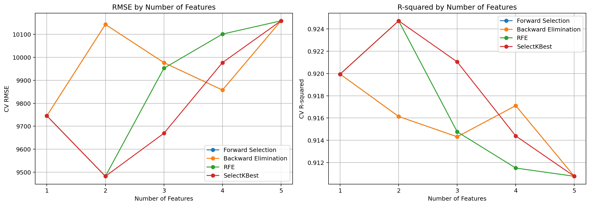
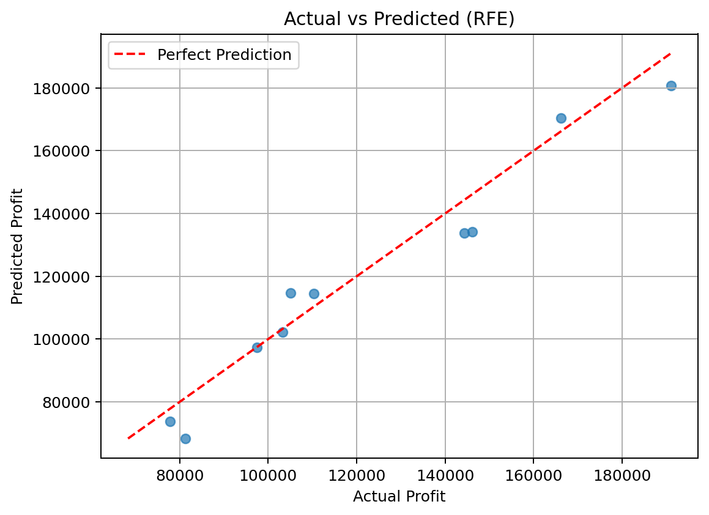

# 50 Startups：支出與獲利的迴歸研究

## 1. 商業理解

目標為預測新創公司的 Profit，並比较模型複雜度與預測表現。模型適合教學與探索關聯，無法證明提高研發或行銷支出會導致相應的獲利增加。

## 2. 資料理解

使用原程式指定的 50 Startups CSV：50 筆、5 欄，無缺失值。數值輸入為 R&D Spend、Administration、Marketing Spend，類別輸入為 State，目標為 Profit。原始資料已附於專案，SHA-256 與版本記錄在 report_data.json。

## 3. 資料準備

以固定 seed=0 切分 40 筆訓練與 10 筆測試。State 採 drop-first 獨熱編碼，以 California 為基準，產生 Florida / New York 指示變數；加上三項支出共有五特徵。外層驗證折內擬合 preprocessing 和 StandardScaler。

## 4. 模型建立

四種方法（Forward Selection、Backward Elimination、RFE、SelectKBest）比較 k=1–5；k=5 為完整 OLS 基準。Forward / Backward 使用內層三折負 RMSE 選擇特徵，RFE 以係數遞迴移除，SelectKBest 以 F 檢定排序。第五種 Lasso 使用 LassoCV 自動選 alpha，係數歸零代表移除特徵，使用其收縮後係數直接預測。

## 5. 評估

外層五折 CV 的平均 RMSE 用於選擇 k 及方法。RFE / SelectKBest 同為最小 9,482.34，依原程式順序保存 RFE，保留研發與行銷支出。

| 方法 | CV 最佳特徵數 | Test MAE | Test RMSE | Test R² |
|---|---:|---:|---:|---:|
| Forward Selection | 1 | 6,772.45 | 8,274.87 | 0.946459 |
| Backward Elimination | 1 | 6,772.45 | 8,274.87 | 0.946459 |
| RFE | 2 | 6,886.59 | 8,198.80 | 0.947439 |
| SelectKBest | 2 | 6,886.59 | 8,198.80 | 0.947439 |
| Lasso | 2 | 6,687.22 | 8,484.57 | 0.943711 |

不同指標的排序未必相同，例如 Lasso 的 MAE 最低，但本研究依事先設定的 CV RMSE 選模。詳細 MSE、CV R²、所有 k 的結果與選取特徵請見 CSV。

同一組特徵在不同方法下可能得到不同 CV 分數，因為各折重新選擇的特徵可能不同；表格顯示的 Selected Features 是在完整 40 筆訓練資料上擬合後的結果。

## 6. 部署

保存訓練於 40 筆資料的完整 Pipeline，包含編碼、標準化、選擇器及線性模型。公式還原為原始單位，所有 21 個模型的公式均與 Python 測試預測逐一比對。前端試算使用未四捨五入的係數，無需遠端模型服務。

範例：R&D=120000、Administration=130000、Marketing=250000、State=California，最佳模型預測 Profit=149124.69。

## 限制與後續研究

- 50 筆小樣本且只有一次固定切分；結果不應推廣到所有新創公司。
- 最佳 CV 分數來自同一組搜尋結果，存在選模偏誤；後續可使用完整巢狀交叉驗證。
- 沿用原程式時，SFS / LassoCV 內層切分前已完成外層訓練資料的預處理，並非完全巢狀的預處理調參。
- 不宣稱更多特徵必然導致過度擬合；不對係數做未計算的显著性推論。
- 互動探索不能取代新的獨立評估，不應依這 10 筆測試反覆選模型。
- 後續可增加樣本、檢查異質變異與殘差假設，並在完整巢狀流程中評估選擇穩定度。

來源、原始程式與執行方式詳見 README.md。
