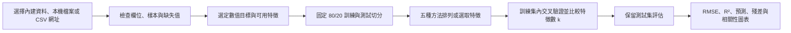

# Startup Lab 工作流程

本專案以多元線性迴歸探索資料與目標欄位的關係。內建 **50 Startups** 與 **Boston Housing** 兩份資料；網站也可讀取使用者選擇的本機 CSV/TSV，或可直接存取的 CSV 網址。所有來源共用同一套網站資料探索與模型評估介面。

## 整體流程



網站互動分析在瀏覽器中執行；另有兩份 Python 實驗，可重跑並產生各自的報告資料。這兩條流程的切分種子與部分方法實作不同，指標應在各自流程內比較。

## CRISP-DM 六階段

| 階段 | 專案中的工作 |
|---|---|
| 1. 商業理解 | 以可用特徵預測指定的數值目標；內建範例分別預測 `Profit` 與 `MEDV`。 |
| 2. 資料理解 | 檢視資料列、欄位、缺失值、前幾筆資料、散點圖及數值欄位相關性。 |
| 3. 資料準備 | 選擇目標欄位，保留有效目標值；處理數值缺失與低類別數量的文字欄位，切出訓練與測試集。 |
| 4. 模型建立 | 比較 Forward SFS、Backward Elimination、RFE、SelectKBest、Lasso；以多元線性迴歸建立預測模型。 |
| 5. 模型評估 | 在訓練資料中比較不同特徵數的交叉驗證 RMSE / R²，再查看保留測試集的 RMSE / R²、實際與預測值及殘差。 |
| 6. 部署應用 | `dist/` 是靜態網站，可於本機開啟或部署到靜態主機；使用者可切換資料集重新探索。 |

## 網站互動流程

1. 開啟 `dist/index.html`，從「資料集來源」下拉選單選擇 **50 Startups**、**Boston Housing**、**從本機載入**或**從網址載入**。網址需指向可直接讀取且允許跨站請求的 CSV；Kaggle 資料頁網址通常不能當作 CSV 直接使用。
2. 確認資料摘要與預覽。用 X/Y 欄位選單切換散點圖，並在研究流程區選擇要預測的數值目標。
3. 在模型探索區選擇五種方法之一與特徵數 `k`，或按 **Compare All 5** 比較交叉驗證曲線。切換資料集、目標或方法後，網站會依目前資料重新計算。
4. 查看 CV RMSE / R²、Test RMSE / R²、保留特徵、實際與預測圖、測試集殘差分布及相關性表。特徵選擇與 `k` 應優先依訓練集交叉驗證判斷；測試集用於最後評估。

瀏覽器會用固定種子 42 將有效資料切成約 80% 訓練、20% 測試，對訓練資料進行最多 5 折驗證；目標欄位至少需要 15 筆有效數值。數值缺失以訓練資料的中位數補值；類別欄位只處理類別數 2–12 的情況，轉為指示變數。網站最多取前 40 個產生的特徵，`k` 最多探索 10。載入的自訂資料僅在當前瀏覽器頁面處理，重新整理後須再次選取。

網站的五種方法是 JavaScript 互動實作。Lasso 選項以 L1 權重排序特徵，選定 `k` 後再以線性迴歸評估；它與下述 Python 的 `LassoCV` 直接預測流程不同。其他方法在瀏覽器中的選擇步驟也不保證逐項等同 scikit-learn，因此兩邊分數不可混用。

## Python 實驗與輸出

在專案根目錄，以 PowerShell 執行：

```powershell
python -m venv .venv
.\.venv\Scripts\python.exe -m pip install -r requirements.txt
.\.venv\Scripts\python.exe train.py
.\.venv\Scripts\python.exe boston-housing\train.py
.\.venv\Scripts\python.exe boston-housing\generate_charts.py
```

`train.py` 使用 `data/50_Startups.csv`、固定種子 0 的 80/20 切分（40 筆訓練、10 筆測試），產生 `results/` 中的特徵選擇比較、測試預測、模型檔與圖表，並透過 `export_report.py` 更新網站使用的 50 Startups 報告資料。四種逐 `k` 方法搜尋 1–5 個特徵，另外比較 `LassoCV`。

`boston-housing/train.py` 使用 `boston-housing/data/BostonHousing.csv`，以 `MEDV` 為目標、13 個原始特徵，同樣採固定種子 0、80/20 切分與 5 折交叉驗證。四種逐 `k` 方法搜尋 1–13 個特徵，另比較 `LassoCV`。結果保存在 `boston-housing/results/`；`generate_charts.py` 更新圖表，網站所需的 Boston 分析資料位於 `dist/boston-analysis.js`。詳細實驗說明見 [Boston Housing README](boston-housing/README.md)。

兩份 Python 實驗的模型結果由各自程式與資料產生。固定測試集只用於模型選定後的評估；若更換資料、套件版本或方法參數，應重新執行並檢查輸出。

## 本機檢查與發布檔案

```powershell
python -m http.server 8000 --directory dist
```

瀏覽 `http://localhost:8000/`，逐一確認內建資料切換、CSV 載入、目標欄位、五種方法與圖表。停止伺服器請按 `Ctrl+C`。若要重新產生網站的「下載專案」壓縮檔，執行 `python package_project.py`；它會更新 `dist/report.js` 並建立 `dist/startup-lab-source.zip`。完成本機檢查後，再由專案維護者決定何時提交與發布。
